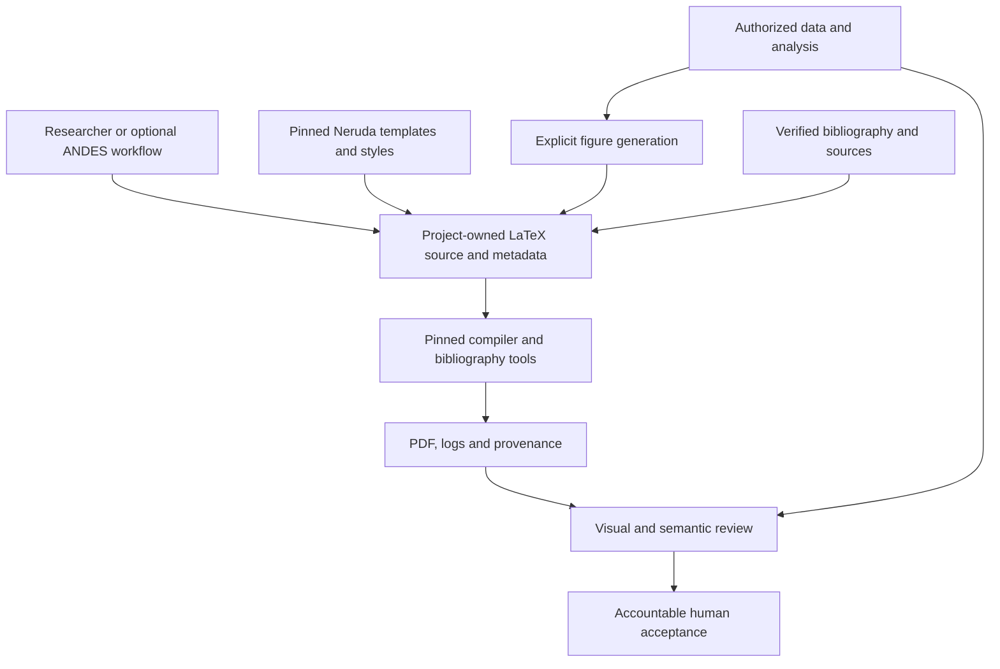
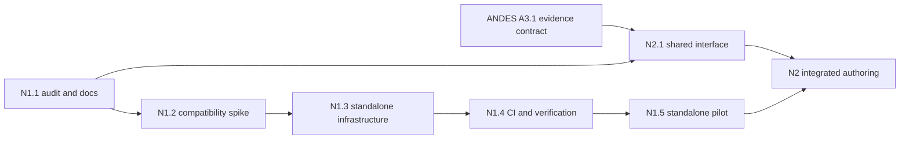

# Neruda architecture

**Status:** conceptual architecture accepted; implementation and compatibility pending. See [ADR-001](docs/decisions/ADR-001.md), [design baseline](docs/design-baseline.md) and [extraction inventory](upstream/LaTexProjects.md).

## System context and boundaries



Neruda owns reusable infrastructure; research projects own manuscripts, sources, evidence and publication decisions. ANDES owns agentic scientific reasoning and authoring/review workflows; it is optional for a standalone Neruda build. Integration uses versioned contracts, not imported ANDES runtime state. There is no mandatory frontend, web backend, database or hosted deployment. The user-facing boundary is a verified scaffold/build/check interface and human-editable source; exact distribution and invocation format remain discovery decisions.

## Components

| Boundary | Responsibility | Implementation evidence |
|---|---|---|
| `tex/` | Shared semantic macros, quantities, math and versioned DRAGGON style/Beamer theme | Package dependencies, source license/branding review, verified rendered templates |
| `templates/` | Minimal article and 16:9 slide starters, modular source, metadata, bibliography and evidence layout | Cleared extraction inventory, placeholder/synthetic content review, no working papers copied |
| `tools/` | Reviewed compiler, bibliography and bundle compatibility pins and archive checksums | N1.2 real platform/clean-build evidence and explicit install approvals |
| `scripts/` | Non-installing preflight, safe scaffold, explicit build/log checks | N1.3 tests for existing/unsafe destinations, missing tools, failures and source preservation |
| Figure interface | Explicit script/notebook/TikZ generation with versioned inputs and output artifacts | Data/code/environment provenance; no shell escape for hidden generation |
| Evidence interface | Project-level claim/evidence references, data/source identities, figure and build receipts | A3.1/N2.1 cross-repository contract; validate valid/invalid fixtures |
| `examples/`, `tests/`, CI | Synthetic standalone paper/slide fixture, clean build, negative checks and rendered artifact inspection | N1.4/N1.5; CI permission isolation and no private documents |
| Release records | Independent version, compatibility matrix, changelog, migration and rollback | Human approval of exact immutable identity and relevant G0/G4 evidence |

Paths are proposed and should be introduced only when implemented. Do not scaffold empty modules or invent commands. Prefer simple scripts and reviewed TeX packages; language and package distribution choices require a bounded compatibility spike.

## Logical project and data model

```text
publication/
  Tectonic.toml             # illustrative historical manifest convention
  src/
    main.tex                # small entry point
    metadata.tex            # authorship, title, source references
    sections/               # split by scientific responsibility
    bib/references.bib
  figures/
    source/                 # explicit generation scripts or source
    generated/              # stable PDF/PNG consumed by source
  data/
    raw/                    # immutable data or controlled references
    processed/              # analysis products and lineage
  sources/
    documents/              # reference metadata or licensed material
    images/                 # attribution, origin, license, modification
  build/                    # compiled PDF and logs
```

Adapt the physical layout as needed but maintain stable semantic references and versioned evidence. Avoid hard-coded reference numbers. Keep raw inputs immutable, permitted or externally referenced; never copy restricted data to make a build run. Every important claim references an experiment, protocol, code/data version and analysis artifact, or is marked unsupported/not evaluated. A document build records source revision and dirty state, template/compiler/bundle/bib/font/figure identity, environment, command, exit/log, page count and PDF checksum; record omissions and reviewer disposition. These are logical fields, not a final JSON schema. A3.1/N2.1 will define shared evidence references and fixtures. Build evidence does not replace scientific evidence.

## Build and validation flow

1. Inspect revision, approved task, selected template and tool versions. Verify the environment without installing or mutating it. If a dependency is unavailable, diagnose and request separate authorization before exact proposed changes.
2. Scaffold or open project-owned source, preserving existing work. Check path containment, destination collisions and template version. Resolve controlled data/source references only within authorized scope.
3. Generate figures explicitly from reviewed inputs; record outputs and provenance. Prefer vector PDF for plots/diagrams, appropriate lossless raster for images, accessible color/labels/units.
4. Compile using the reviewed standalone toolchain with shell escape disabled by default; do not silently fall back to a different engine, bibliography or renderer. Retain logs and exact build identity. Cache material for an already pinned bundle is distinct from permission to update pins or install/repair tools.
5. Check references, citations, missing input and warnings. Inspect every rendered page/slide for clipping, overlap, overfull boxes, typography, accessibility, legends and readability; distinguish scientific and editorial review. Validate citation relevance and scientific claims independently. Human accepts final content and releases; target-journal class/engine may override lab defaults via explicit reviewed adaptation.

## Environment and deployment

Reference upstream: LaTexProjects Tectonic 0.17.0, `tlextras-2022.0r0`, Biber 2.17 (matched biblatex 3.17), no shell escape. Current checked source declares Tectonic manifest v2 and uses Unicode/fontspec/unicode-math. Shared style rejects pdfTeX. Historical wrapper paths and pinned archive coverage are not portable guarantees; see [inventory](upstream/LaTexProjects.md). In N1.2 choose a minimal compatibility unit and document exact supported OS/architecture, binaries/archives, hashes, cache/network policy, font and bibliography dependencies. CI and local commands must agree. Validate against clean workspaces and supported configurations, including paths containing spaces if supported; no host-local fallback or project-specific workshop environment. Preserve upstream projects untouched.

No mandatory Docker Compose or container deployment. A reviewed reproducible build container may be introduced if clean native environments cannot meet requirements or CI needs it; record image pin and evidence. Do not assume a global TeX or Python environment. Each figure-generation project owns its dependencies and locks. Avoid installing unreviewed binaries, disabling security controls or changing the toolchain without permission. Treat third-party TeX, fonts, images, bibliography and publisher files as untrusted inputs with applicable terms.

## Test, operational and privacy model

- Mechanical: version/hash checks, safe paths/scaffold, missing tools and invalid inputs, log parsing and reference resolution, no shell escape, no dependence on local legacy directories. Test negative fixtures and interrupted actions without destructive cleanup.
- Standalone: fresh synthetic article and slide builds without ANDES; include actual build outputs, page counts and logs. Use semantic/controlled artifact identity checks rather than unproven bitwise equality; record time policy, fonts and figure versions.
- Visual/scientific: check every page, compare before/after theme revisions, verify ordered equation symbol definitions, evidence and citations, like-for-like comparisons, handout readability and limitations. Reviewer evaluates actual PDF, not only source diff.
- Security/provenance: public CI builds only public-safe synthetic inputs with least privilege; never upload restricted PDFs, raw data, private traces, credentials or unlicensed sources. External adapters may reference controlled identifiers; do not require external content in a public fixture.
- Human approval: scientific claims, disclosures, authorship, permissions, publication, stable release, installation and material dependency changes need appropriate human authorization.

## Delivery and open decisions



This is a scope/dependency sketch; the approved backlog governs exact task edges. N1.1 introduces no code or build workflow. Remaining decisions: clean platform support and compiler/bib/bundle/font pin; portable scaffold location and template packaging; license/branding clearance; path safety, version and cache verification; independent build and visual review; shared evidence schema. Historical upstream CI is evidence of intended behavior, not a current verified build. Keep standalone toolchain independent of ANDES; align optional authoring via N2.1. See [PRODUCT.md](PRODUCT.md) for release outcomes.
